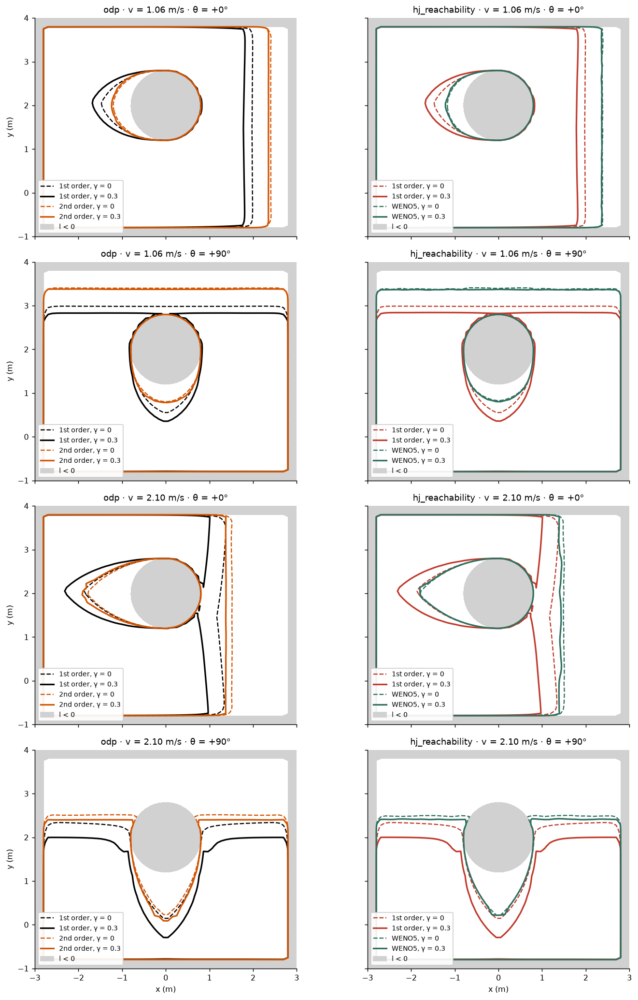
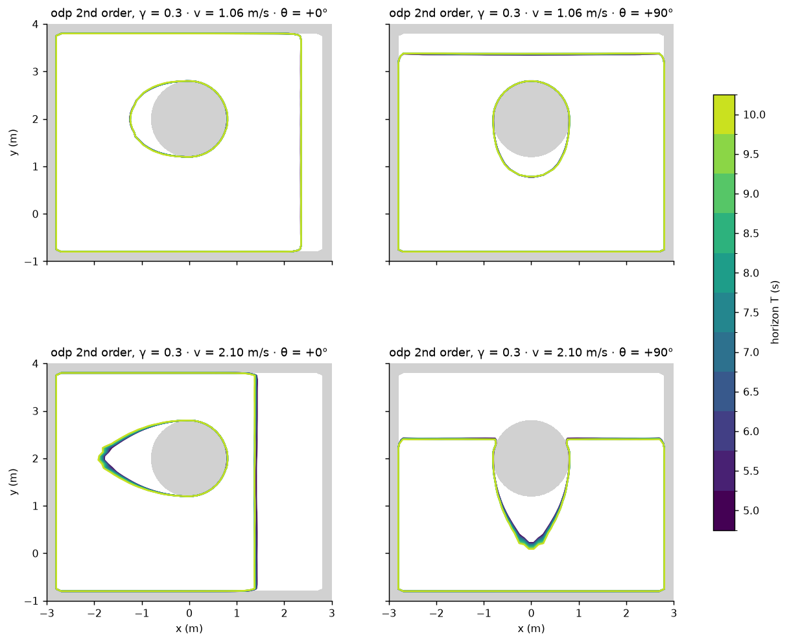
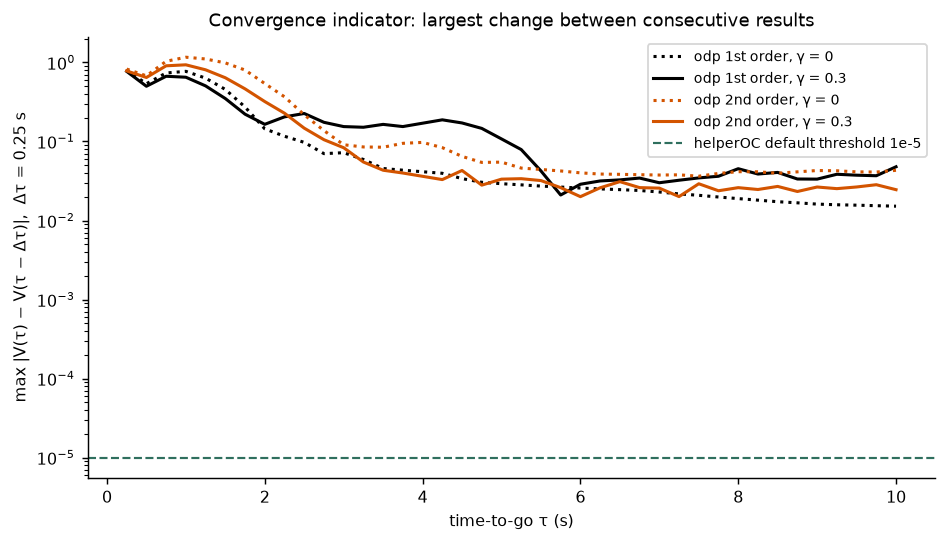

# Optimized Dynamic Programming-Based Algorithms Solver (OptimizedDP)
The repo contains implementation of dynamic programming based algorithms in optimal control. Specifically, the solver supports 3 main classes of algorithms: level set based algorithm for solving Hamilton-Jacobi-Issac (HJI) partial differential equation (PDE) arising in reachability analysis and differential games [1], time-to-reach (TTR) computations of dynamical systems in reachability analysis [2], and value-iterations algorithm for solving continuous state-space action-space Markov Decision Process (MDP). All these algorithms share the property of being implemented on a multidimensional grid and hence, their computational complexities increase exponentially as a function of dimension. For all the aforementioned algorithms, our toolbox allows computation up to 6 dimensions, which we think is the limit of dynammic programming on most modern personal computers.
<div align="center">
    
</div>        

<!--  -->

In comparison with previous works, our toolbox strives to be both efficient in implementation while being user-friendly. This is reflected in our choice of having Python as a language for initializing problems and having python-like HeteroCL [3] language for the core algorithms implementation and dynamical systems specification. Our implementation is 7-32x faster than the [Level Set Toolbox](https://github.com/risk-sensitive-reachability/ToolboxLS) and [HelperOC](https://github.com/HJReachability/helperOC) and 2-3x faster than [BEACLS](https://hjreachability.github.io/beacls/) implementation in C++. Please find more details about using the repo for solving your problems in this page, and should you have any questions/problems/requests please direct the messages to Minh Bui at buiminhb@sfu.ca 

# Quickstart (Ubuntu 18, 20, 22)
Please install the following:
* Install Anaconda (https://docs.anaconda.com/anaconda/install/linux/)
* Create a virtual environemnt using the provided `environment.yml`

    ``` conda env create -f environment.yml ```
    
* Install the `optimized_dp` repository

    ``` pip install -e . ```
* Note: If you're on Ubuntu 20.04 or 22.04, you may have encounter an error regarding ``` libtinfo5 ```. 
  To fix, please just run this command 

    ```sudo apt install libtinfo5 ``` 

### Windows (WSL 2)
HeteroCL 0.3 only ships Linux builds, so on Windows use WSL 2 with Ubuntu 22.04 and follow the Linux steps inside it:
```bash
# PowerShell (admin), only if Ubuntu 22.04 is not installed yet; reboot afterwards
wsl --install -d Ubuntu-22.04

# Inside Ubuntu 22.04
sudo apt-get update && sudo apt-get install -y libtinfo5 git wget
wget https://repo.anaconda.com/miniconda/Miniconda3-latest-Linux-x86_64.sh
bash Miniconda3-latest-Linux-x86_64.sh -b -p ~/miniconda3 && ~/miniconda3/bin/conda init bash && exec bash
# recent conda versions require accepting the Terms of Service of the default channels
conda tos accept --override-channels --channel https://repo.anaconda.com/pkgs/main
conda tos accept --override-channels --channel https://repo.anaconda.com/pkgs/r
git clone https://github.com/GuanQinG-GitHub/optimized_dp.git && cd optimized_dp
conda env create -f environment.yml && conda activate odp && pip install -e .
python examples/dubins_4d_avoid.py   # sanity check: ends with "Finished solving"
```


# Example: avoid problem with a grid-based SDF obstacle map
[`examples/dubins_4d_avoid_sdf.py`](examples/dubins_4d_avoid_sdf.py) solves the same problem as `examples/dubins_4d_avoid.py` (4D Dubins car, same grid, 1.5 s backward reachable tube), but the target set l(s) is the **signed distance function of an indoor layout** (walls, a partition with a doorway, tables, shelves) instead of an analytic cylinder:

occupancy grid (2 cm) → Euclidean distance transform → signed distance (m) → bilinear resampling onto the odp (x, y) grid → broadcast over v and θ.

```bash
conda activate odp
cd optimized_dp
python examples/dubins_4d_avoid_sdf.py          # build SDF, solve, save to results/dubins_4d_avoid_sdf/ (~28 MB)
python examples/dubins_4d_avoid_sdf_report.py   # build results/dubins_4d_avoid_sdf/report.html (~18 MB)
```
* `results/` is git-ignored; rerun the two commands to regenerate it.
* Saved outputs: `occupancy.npy`, `sdf_map.npy`, `sdf_analytic.npy`, `map_x.npy`, `map_y.npy`, `l_xy.npy`, `V_terminal.npy` (V at t = T), `V_vslice_all_t.npy` (all time steps at v = 2.11 m/s) and `run_info.json` (setup, timings, versions).
* The report shows the SDF (with validation against the exact distance), a playable 3D animation of the unsafe set, 2D slices at the terminal time for headings 0°, ±90°, 180°, and the math and numerical setup with timings. KaTeX for the formulas loads from a CDN; everything else is inlined.
* Reference run (AMD Ryzen 7 9700X, 16 threads, WSL 2): SDF build ≈ 25 ms, HJSolver ≈ 12 s (kernel ≈ 11.4 s, 210 sub-steps); unsafe grid points grow from 24 % to 50 %.
* To use your own map, replace the rasterized `occ` in `build_l()` with your boolean occupancy grid and set `map_x`/`map_y` to its cell-center coordinates in meters; `sdf_from_occupancy()` and the resampling stay the same. Set `ROBOT_RADIUS` to inflate obstacles by the robot footprint.


# Discounted avoid problem (`HJSolver(..., discount=gamma)`)
`HJSolver` takes an optional `discount=gamma` (default `0.0`, which is the original solver) and solves the discounted HJ variational inequality

    0 = min{ l(x) - V(x,t),  D_t V + max_u min_d D_x V . f(x,u,d) - gamma V }

In time-to-go each Runge-Kutta stage integrates `dV/dtau = H - gamma V`; the usual `TargetSetMode` clamp (`"minVWithV0"`: `V <- min(V, l)`) follows. The solution is `V(x, tau) = max_u min_{s <= tau} e^{-gamma s} l(x(s))`, so unsafe states have **V < 0** and safe states decay toward **0** (with `l < 0` inside obstacles).

```bash
conda activate odp
cd optimized_dp
python -m pytest -q test/test_discount.py               # closed-form check + zero-level invariance (2 tests)
python examples/dubins_4d_avoid_discounted.py           # bounded 4D Dubins avoid, gamma = 0.3, T = 10 s, accuracy="medium" (~100 s)
python examples/dubins_4d_avoid_discounted_view.py      # HTML review page with an animation of V over time-to-go
python examples/discount_boundary_demo_1d.py            # 1D demo: why the grid boundary must be unsafe (~30 s)
```

**Notes from testing (4D Dubins car, 60×60×24×36 grid):**
* **Put the state boundary into `l`.** Every non-periodic grid edge must lie in a margin where `l < 0` (e.g. walls of thickness 0.2 m, and an extended speed grid with out-of-range speeds unsafe). Otherwise trajectories that leave the grid keep safe values pinned at `l`, because the ghost cells are extrapolated from `V` and never discounted (`examples/discount_boundary_demo_1d.py`).
* **Use `accuracy="medium"` (2nd order).** With the 1st-order solver (`"low"`) we observed two issues: it is already too conservative at `gamma = 0` (about 145k more unsafe grid points than 2nd order), and the discount then erodes its safe set (about 16% of the safe set lost at `gamma = 0.3`, `T = 10 s`, vs about 5% for 2nd order). The same happens in [hj_reachability](https://github.com/StanfordASL/hj_reachability) with its 1st-order scheme, so it is a property of the scheme, not of this code.
* **Caveats of 2nd order:** after about 8 s the largest safe values stop decaying (a plateau above the `e^{-gamma T} max l` bound), and the zero level keeps creeping slowly into free space (about 0.8% of the safe set per second). There is no strict convergence on this grid: the max absolute difference between consecutive results levels off around 0.02–0.05 per 0.25 s, far above e.g. helperOC's default threshold of 1e-5. Pick `T` by the accuracy you need rather than waiting for convergence.
* helperOC's discount (`extraArgs.discountFactor`) is a different formulation, `V <- lambda V + (1 - lambda) l` once per time step, whose safe values stay on the scale of `l` rather than going to 0.

Zero-level sets at T = 10 s, odp (left) vs hj_reachability (right), `gamma = 0` dashed vs `gamma = 0.3` solid, low order vs high order:



odp 2nd order, `gamma = 0.3`: zero-level sets for horizons T = 5, 5.5, …, 10 s:



Convergence indicator `max |V(tau) - V(tau - 0.25 s)|` over the whole grid:



**Computation time** (bounded 4D example, 3.11M grid points, T = 10 s, output every 0.25 s; AMD Ryzen 7 9700X, 16 threads, WSL 2, CPU only):

| Solver | `gamma = 0` | `gamma = 0.3` |
|---|---|---|
| odp, `accuracy="low"` (1st order) | 45 s | 50 s |
| odp, `accuracy="medium"` (2nd order) | 102 s | 101 s |
| hj_reachability, 1st order (JAX, CPU) | 108 s | 127 s |
| hj_reachability, WENO5 + RK3 (JAX, CPU) | 410 s | 455 s |

The discount itself adds no measurable cost.


# Solving the Hamilton-Jacobi-Issac (HJI) PDE
* We provide a running example of solving HJI PDE in the file [`examples/plotting_example.py`](https://github.com/SFU-MARS/optimized_dp/examples/examples.py):
```python
# STEP 1: Define grid
grid_min = np.array([-4.0, -4.0, -math.pi])
grid_max = np.array([4.0, 4.0, math.pi])
dims = 3
N = np.array([150, 150, 150])
pd=[2]
g = Grid(grid_min, grid_max, dims, N, pd)

# STEP 2: Generate initial values for grid using shape functions
center = np.zeros(dims)
radius = 1.0
ignore_dims = [2]
Initial_value_f = CylinderShape(g, ignore_dims, center, radius)

# STEP 3: Time length for computations
Lookback_length = 1.0
t_step = 0.05

small_number = 1e-5
tau = np.arange(start=0, stop=Lookback_length + small_number, step=t_step)

# STEP 4: System dynamics for computation
sys = DubinsCapture(uMode="max", dMode="min")

# STEP 5: Initialize plotting option
po1 = PlotOptions(do_plot=False, plot_type="set", plotDims=[0,1,2])

# STEP 6: Call HJSolver function
compMethod = { "TargetSetMode": "None"}
result_3 = HJSolver(sys, g, Initial_value_f, tau, compMethod, po1, saveAllTimeSteps=True)
```
* To run the example, execute the command `python3 examples/plotting_example.py`
* If the parameter `do_plot` is set to `True`, when initializing `PlotOptions`. The parameter `saveAllTimeSteps` is set to `False` in `HJSolver`, an static 3D plot will show on pop-up browser.
<!--  -->
<div align="center">

</div>        

* If interactive 3D animation needs to be visualized, and outputs need to be saved locally
```python
# While file needs to be saved locally, set save_fig=True and filename, recommend to set interactive_html=True for better visualization
po2 = PlotOptions(do_plot=False, plot_type="set", plotDims=[0,1,2],
                  slicesCut=[1], colorscale="Bluered", save_fig=True, filename="plots/3D_0_sublevel_set", interactive_html=True)

# STEP 6: Call Plotting function
plot_isosurface(g, result_3, po2)
```

<!-- * Check the interactive result [`images/3D_0_sublevel_set.html`](https://github.com/SFU-MARS/optimized_dp/images/3D_0_sublevel_set.html) -->


* For computing result higher than 6D, check [`examples/examples.py`](https://github.com/SFU-MARS/optimized_dp/examples/examples.py)
* Notes: For 6 dimensions, recommended grid size is 20-30 each dimension on system with 32Gbs of DRAM.
* Create a class file in folder dynamics/ to specify your own system dynamics. Remember to import the class in your running example.  

## System dynamics specification
It can noticed in ```user_definer.py``` that the class DubinsCapture is imported from the folder ```dynamics/```, where our example system dynamics. 
```python 
import heterocl as hcl

class DubinsCapture:
    def __init__(self, x=[0,0,0], wMax=1.0, speed=1.0, dMax=1.0, uMode="max", dMode="min"):
        self.x = x
        (...)
        self.dMode = dMode

    def opt_ctrl(self, t, state, spat_deriv):
        """
                :param  spat_deriv: tuple of spatial derivative in all dimensions
                        state: x1, x2, x3
                        t: time
                :return: a tuple of optimal disturbances
        """

        (...)
        return (opt_w[0], in3[0], in4[0])

    def opt_dstb(self, t, state, spat_deriv):
        """
            :param spat_deriv: tuple of spatial derivative in all dimensions
                    state: x1, x2, x3
                    t: time
            :return: a tuple of optimal disturbances
        """
        (...)        
        return (d1[0], d2[0], d3[0])

    def dynamics(self, t, state, uOpt, dOpt):
        (...)
        return (x_dot[0], y_dot[0], theta_dot[0])
``` 


# Time-to-Reach computation
* We have provided an example in [`examples/TTR_example.py`](https://github.com/SFU-MARS/optimized_dp/examples/TTR_example.py):
```python
# -------------------------------- ONE-SHOT TTR COMPUTATION ---------------------------------- #
g = Grid(minBounds=np.array([-3.0, -1.0, -math.pi]), maxBounds=np.array([3.0, 4.0, math.pi]),
         dims=3, pts_each_dim=np.array([50, 50, 50]), periodicDims=[2])
# Car is trying to reach the target
my_car = DubinsCar(uMode="min")

# Initialize target set as a cylinder
targetSet = CylinderShape(g, [2], np.array([0.0, 1.0, 0.0]), 0.70)
po = PlotOptions( "3d_plot", plotDims=[0,1,2], slicesCut=[],
                  min_isosurface=lookback_length, max_isosurface=lookback_length)

# Convergence threshold
epsilon = 0.001
V_0 = TTRSolver(my_car, g, targetSet, epsilon, po)
```
* To run the example : `python3 TTR_example.py`
# Current code structure
* solver.py: Containing python APIs to interact with the numerical solver
* dynamics/ : User's dynamical system specification
* Shapes/ShapesFunctions.py : Add-in functions for initializing different shapes/intial value functions
* computeGraphs/CustomGraphFunctions.py: Ready-to-user HeteroCL style utility functions

### Paper and Citation (Bibtex)  
Please cite our paper (https://arxiv.org/abs/2204.05520) if you use the toolbox in your research:
```
@misc{https://doi.org/10.48550/arxiv.2204.05520,
  doi = {10.48550/ARXIV.2204.05520},
  url = {https://arxiv.org/abs/2204.05520},
  author = {Bui, Minh and Hu, Hanyang and He, Chong and Lu, Michael and Giovanis, George and Shriraman, Arrvindh and Chen, Mo},
  keywords = {Systems and Control (eess.SY), FOS: Electrical engineering, electronic engineering, information engineering, FOS: Electrical engineering, electronic engineering, information engineering},
  title = {OptimizedDP: An Efficient, User-friendly Library For Optimal Control and Dynamic Programming},
  publisher = {arXiv},
  year = {2022}, 
  copyright = {Creative Commons Attribution 4.0 International}
}
```  


# Related Projects
### MATLAB
* [A Toolbox of Level Set Methods ](https://www.cs.ubc.ca/~mitchell/ToolboxLS/)
* [helperOC](https://github.com/HJReachability/helperOC)
### C++
* [BEACLS](https://hjreachability.github.io/beacls/)
### Python/JAX
* [hj_reachability](https://github.com/StanfordASL/hj_reachability)

# References
[1] "Hamilton–Jacobi Reachability: Some Recent Theoretical Advances and Applications in Unmanned Airspace Management" by Mo Chen and Claire J. Tomlin in 
Annual Review of Control, Robotics, and Autonomous Systems 2018 1:1, 333-358 [pdf](https://sfumars.com/wp-content/papers/2018_ar_hjreach.pdf)

[2] "One-Shot Computation of Reachable Sets for Differential Games" by Insoon Yang [pdf](https://dl.acm.org/doi/pdf/10.1145/2461328.2461359?casa_token=GmZ6JB2DhLwAAAAA:qRSxxQisIcNpNo6nJHWbi5lRSmxFWk_gL2dXxilkpPi3PsgwxwPSs5hCdcuV7Elx1PTQ84cAGFQ)

[3] "HeteroCL: A Multi-Paradigm Programming Infrastructure for Software-Defined Reconfigurable Computing" by Yi-Hsiang Lai [pdf](https://vast.cs.ucla.edu/~chiyuze/pub/fpga19-heterocl.pdf)

